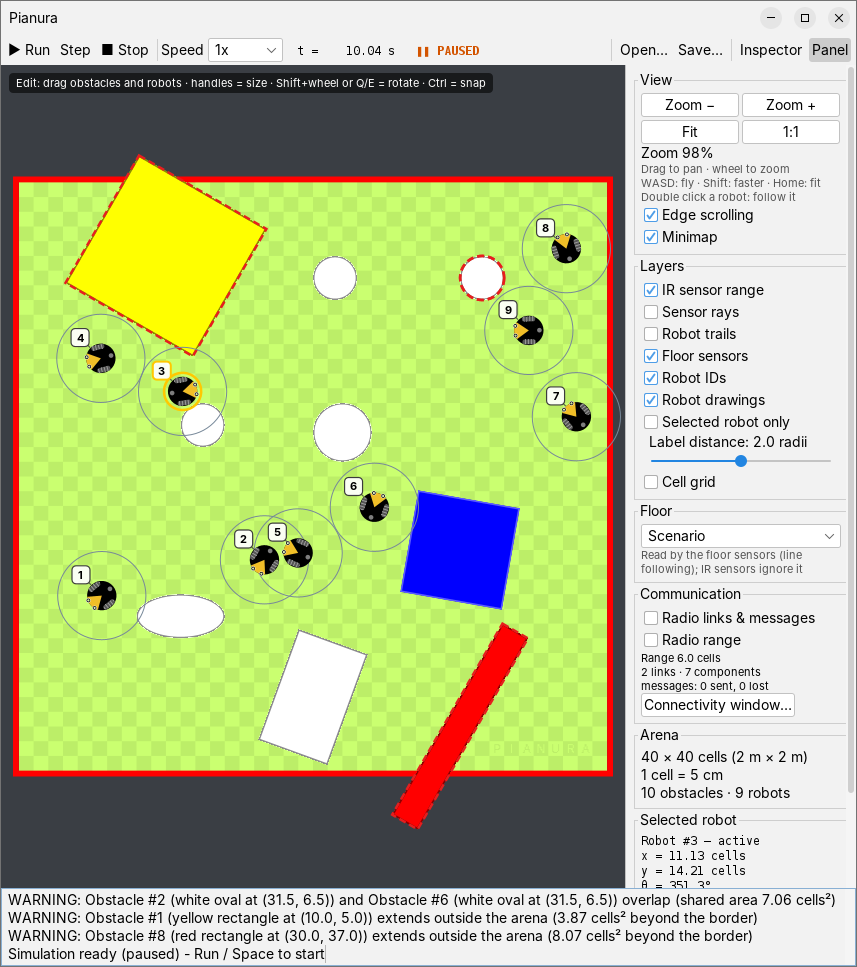
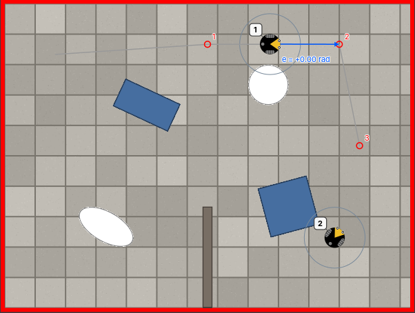
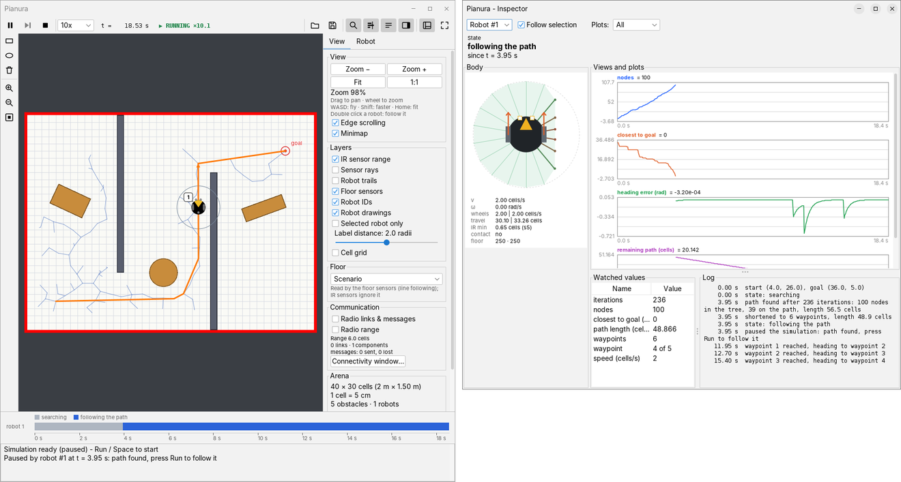

# Pianura

**A lightweight 2D simulator for differential-drive mobile robots, written in Java.**

Pianura is a simple, self-contained simulator for prototyping and testing mobile-robot
algorithms: navigation, obstacle avoidance, line following, multi-robot coordination and
swarms. You write a robot in a few lines of plain Java, or drive it from any language over
UDP, and watch it move in a 2D arena.

It is meant for students, teachers and researchers who want something that starts with a
single command and can be read and modified in an afternoon, in Java, Python or MATLAB.

Pianura is complementary to full robot simulators such as **Webots** and **Gazebo**, not a
replacement: it trades 3D physics, cameras and detailed robot models for a flat world where
an algorithm is quick to write, to watch and to repeat, even with dozens of robots. Learn and
prototype here; when you need realistic physics, real sensor models or ROS 2, move to one of
them.

Pianura is the evolution of **JUSE** (Java UniBot Simulation Environment), a simulator
written in 2008 and used for years at the University of Bologna; see [Origins](#origins).



---

## Features

- **Differential-drive kinematics**: exact integration on the instantaneous centre of
  curvature, Runge-Kutta for straight motion
- **Sensors**: 18 infrared range sensors and 18 bump sensors per robot, computed by
  geometric ray casting; optical floor sensors for line following
- **Obstacles**: rectangles and ovals, rotated at any angle, with optional borders;
  overlaps and obstacles outside the arena are reported when a scenario loads
- **Simulated clock**: fixed time step, pause, single step and speed control, so runs
  are reproducible
- **Two ways to program a robot**: a sequential control loop, or a controller called
  at a fixed period
- **Reference algorithms and examples** to start from: obstacle avoidance, a Braitenberg
  vehicle, radio beacons, line following, RRT path planning, remote control
- **Debug drawings**: a robot's code draws what its algorithm thinks (paths, targets, trees,
  estimated maps) in named layers over the arena, from Java, Python or MATLAB
- **Inspector**: a separate window with a robot's state, watched values, time plots and log of
  decisions; a robot can pause the simulation on a decision
- **Radio between robots**: range, losses and latency, plus a live connectivity window
  (graph, adjacency and incidence matrices)
- **Remote control over UDP + JSON**, with ready-made Python and MATLAB clients; lockstep
  mode for reproducible experiments, real-time mode for realistic timing
- **Arenas of any size**: zoom, pan and fly over large maps; click or drag on the minimap to
  move the view
- **Floors**: checkerboard, grid, random tiles, Voronoi tiles, a line-following track,
  or any image
- **Scene editing**: before starting or while paused, drag, resize and rotate obstacles and
  robots with the mouse; save the scene to a file and open it again, or load it from code
- No dependencies beyond the JDK; with [FlatLaf](https://www.formdev.com/flatlaf/) on the
  classpath the window takes a modern look (the examples include it)

---

## Requirements

- A JDK, version 21 or later (25 LTS recommended), e.g. [Eclipse Temurin](https://adoptium.net/)
- Nothing else: the Gradle wrapper is included

---

## Quick start

```bash
git clone https://github.com/Pianura/pianura-sim.git
cd pianura-sim
./gradlew run
```

This opens the example `obstacles`: nine robots avoiding rectangular and oval obstacles.
Examples open paused: arrange the scene if you like, then press **Run** (or Space).

To run another example, pass its name:

```bash
./gradlew run -Pexample=braitenberg
```

The available examples are `timedmotion`, `obstacles`, `rooms`, `linefollowing`, `remote`,
`radio`, `largemap`, `braitenberg` and `planning`. [`examples/README.md`](examples/README.md) says what
each one shows, with screenshots; the controllers they use are described in
[`algorithms/README.md`](algorithms/README.md).

**Look of the window.** The examples use FlatLaf's light theme. For the dark theme, or for the
classic Swing look of JUSE:

```bash
./gradlew run -Dpianura.laf=flat-dark     # or metal, or system (the operating system's look)
```

Pianura itself does not depend on FlatLaf: in your own project the window uses Swing's
standard look unless you add `com.formdev:flatlaf` to the runtime classpath.

---

## Programming a robot

### As a control loop

Extend `RobotDummy` and implement `executeLoop()`. It runs in its own virtual thread and
holds the whole control logic. Use `sleepSim()` instead of `Thread.sleep()`: it waits in
*simulated* time, so pause, single step and speed control work.

```java
import io.github.raffaelegrandi.pianura.units.RobotDummy;
import io.github.raffaelegrandi.pianura.utils.Position;

public class MyRobot extends RobotDummy {

    public MyRobot(int id, Position start, double sensorRange) {
        super(id, start, sensorRange);
    }

    @Override
    public void executeLoop() {
        forward(1.0);                         // 1 cell/s straight ahead
        while (isActive()) {
            double[] ir = getIr();            // 18 IR readings, cells from the body (getIrRange() = clear)
            if (ir[0] < 1.5) {                // obstacle ahead (sensor 0 = front)
                rotateBy(45, 50);             // turn 45° on the spot
                forward(1.0);
            }
            sleepSim(0.2);                    // 0.2 s of simulated time
        }
    }
}
```

### As a periodic controller

Implement `RobotController` and give it to a `ControllerRobot`. The simulator calls
`control()` every control period (here 0.1 s) with the current simulated time. In a
scenario constructor (see below):

```java
addRobot(new ControllerRobot(1, new Position(5, 5, 0), 2, 0.1,
        (robot, t) -> {
            boolean blocked = robot.getIr(0) < 1.5;                      // cells from the body
            robot.setRobotSpeed(blocked ? 0 : 1.0, blocked ? 1.5 : 0);   // cells/s, rad/s
        }));
```

Main methods available on a robot:

| Method | Description |
|--------|-------------|
| `forward(speed)` / `backward(speed)` | Straight on or back, cells/s |
| `setWheelSpeeds(left, right)` | Wheel speeds, cells/s (differential drive) |
| `setRobotSpeed(v, w)` | Linear (cells/s) and angular (rad/s) speed |
| `rotateBy(angleDeg, stepMs)` | Turn on the spot, blocking |
| `getIr()` / `getIr(i)` | IR readings: cells from the body to the nearest obstacle, `getIrRange()` when nothing is in range |
| `hasCollision()` | Whether the robot is touching an obstacle |
| `getFloorGrays()` | Floor sensor readings, 0 = black, 255 = white |
| `broadcast(data)` / `send(id, data)` / `receive()` | Radio messages |
| `getPosition()` | Pose (x, y in cells, theta in radians) |
| `sleepSim(seconds)` / `getSimTime()` | Simulated time |
| `getMetersPerCell()` | Scale of the scenario, meters per cell |

### Units

Pianura measures lengths in **cells**, time in seconds and angles in radians. The robot is a
disc of radius 1 cell with its two wheels 2 cells apart; speeds are in cells/s. Each scenario
declares how big a cell is with `setMetersPerCell(m)` (default 0.05: the robot is 10 cm across,
and 3 cells/s are 15 cm/s). The scale is shown in the side panel and sent to remote clients;
the simulation itself stays in cells. The y axis grows downwards and positive angles turn
clockwise, as on screen.

### Debug drawings

A robot can draw over the arena what its algorithm thinks: the planned path, the target, a
search tree, an estimated map. Drawings live in named layers, in world coordinates (cells),
and never affect the simulation:

```java
Position p = robot.getPosition();
robot.viz("plan").clear()                      // redrawn at every step
     .color(Color.BLUE).polyline(xs, ys)
     .color(Color.RED).disc(goalX, goalY, 0.3).text(goalX + 0.5, goalY, "goal")
     .arrow(p.x, p.y, goalX, goalY);
robot.viz("trail").point(p.x, p.y);            // never cleared: it grows
```

Shapes: `point`, `line`, `arrow`, `circle`, `disc`, `rect` (filled, for map cells), `polyline`,
`polygon`, `text`; `color(...)` and `width(px)` apply to the shapes that follow. A layer keeps its
shapes until `clear()`. What a robot draws appears at its next `sleepSim()`, all at once, so the
picture is always consistent. In the side panel, **Robot drawings** shows or hides them and
**Selected robot only** keeps just the selected robot's. Remote clients draw in the
same way (`draw` in the protocol); the [`BraitenbergVehicle`](algorithms/README.md#braitenberg-braitenbergvehicle)
and the MATLAB example `gotogoal.m` show how.



### The inspector

The **Inspector** button on the toolbar opens a separate window about the selected robot: what
its algorithm is doing (state), a few values it watches, time plots, and a log of its decisions,
all stamped with the simulated time. The robot's code fills it:

```java
Inspector in = robot.inspector();
in.state("searching");                       // a change of state is also logged
in.watch("nodes", tree.size());
in.plot("distance to goal", d);              // one plot per name, against simulated time
in.log("path found, length " + len);
robot.pauseSimulation("path found");         // pauses everything, as the Pause button does
```

Plots show the last 10, 30 or 60 seconds or the whole run. Nothing of this affects the
simulation, and memory is bounded. From Python and MATLAB the same goes through
`robot.inspect.state(...)` / `robot.inspectState(...)` and friends (see
[`clients/README.md`](clients/README.md#inspector)). The example `planning` shows it at work:
an RRT grows under your eyes, the simulation pauses when the path is found, and the inspector
follows the search and the drive.



---

## Building a scenario

Extend `ScenarioManager` and add robots and obstacles. Positions are in cells, angles in
radians.

```java
import io.github.raffaelegrandi.pianura.arena.ArenaObjectType;
import io.github.raffaelegrandi.pianura.arena.Obstacle;
import io.github.raffaelegrandi.pianura.structures.ScenarioManager;
import io.github.raffaelegrandi.pianura.utils.Position;
import java.awt.Color;

public class MyScenario extends ScenarioManager {

    public MyScenario() {
        setArenaSize(40, 30);                                     // cells

        addRobot(new MyRobot(1, new Position(10, 10, 0), 2));
        addRobot(new MyRobot(2, new Position(20, 20, Math.toRadians(90)), 2));

        addObstacle(new Obstacle(ArenaObjectType.OBSTACLE_RECT, Color.GRAY,
                new Position(15, 15, Math.toRadians(45)), 6, 3));    // width, height in cells
        addObstacle(new Obstacle(ArenaObjectType.OBSTACLE_OVAL, Color.WHITE,
                new Position(25, 10, 0), 4, 4));
    }
}
```

Then start it from a `main`:

```java
import io.github.raffaelegrandi.pianura.Simulator;
import java.awt.Point;

public class Main {
    public static void main(String[] args) {
        Simulator sim = new Simulator(new Point(50, 50), "My simulation", new MyScenario());
        sim.startSimPaused();      // opens paused: press Run or Space
    }
}
```

### Scene files

A scene is the stage without the actors: arena size and scale, obstacles, and where each
robot stands (by id). Arrange it with the mouse, then **Save…** in the toolbar (Ctrl+S)
writes it to a JSON file; **Open…** (Ctrl+O) loads one back, before the start or while
paused, replacing the obstacles and moving the robots it lists. The file is short and can be
edited by hand:

```json
{
  "pianura_scene": 1,
  "arena": {"width": 40, "height": 40, "meters_per_cell": 0.05},
  "obstacles": [
    {"shape": "rect", "x": 20, "y": 8, "theta": 0, "width": 30, "height": 1, "color": "#505050"},
    {"shape": "oval", "x": 20, "y": 20, "theta": 0.6, "width": 8, "height": 4, "color": "#3060d0"}
  ],
  "robots": [
    {"id": 1, "x": 4, "y": 4, "theta": 0}
  ]
}
```

A scenario can start from a scene file: the robots' code stays in Java, the layout in the
file. Handy for exercises, where the same robots face different arenas:

```java
public MyScenario() throws IOException {
    addRobot(new MyRobot(1, new Position(0, 0, 0), 2));      // placed where the scene says
    loadScene(Path.of("arena-1.json"));                       // or getClass().getResourceAsStream(...)
}
```

The floor is not part of the scene: it comes from the scenario (`setFloor`) or the side panel.

---

## Remote control

Robots can be driven by any program that speaks UDP and JSON. [`clients`](clients/README.md)
describes the protocol and contains two ready-made clients:

- [`clients/python`](clients/python): Python, standard library only;
- [`clients/matlab`](clients/matlab): MATLAB with no toolbox (or GNU Octave), with a
  go-to-goal example that plots its errors.

---

## Sensor layout

The 18 IR and bump sensors are spaced 20° apart, starting from the robot's heading
(sensor 0 = front) and going clockwise:

```
              [0]               <- front (0°)
         [17]      [1]          <- ±20°
     [16]              [2]      <- ±40°
  [15]                    [3]   <- ±60°
[14]          (R)          [4]  <- ±80°
[13]                       [5]  <- ±100°
  [12]                    [6]   <- ±120°
     [11]              [7]      <- ±140°
         [10]      [8]          <- ±160°
              [9]               <- rear (180°)
```

---

## Project structure

Pianura is a Gradle build with three modules:

```
core/          the simulator: the library (jar name pianura), no dependencies beyond the JDK
algorithms/    reference robot controllers, one package each        → algorithms/README.md
examples/      example scenarios, run with ./gradlew run -Pexample=  → examples/README.md
clients/       Python and MATLAB clients for remote control over UDP
docs/img/      screenshots
docs/brand/    logo and avatar of the Pianura organization
CITATION.cff   how to cite Pianura (GitHub's "Cite this repository")
```

Inside `core`, under `src/main/java/io/github/raffaelegrandi/pianura/`:

```
├── Simulator.java     entry point: wires scenario, simulation engine and GUI
├── sim/               simulation engine and simulated clock
├── units/             robots and controllers
│   ├── collisions/    geometric ray casting, shapes, spatial grid
│   └── sensors/       floor sensors
├── arena/             obstacles and object identifiers
├── structures/        ScenarioManager
├── comm/              radio network between robots
├── remote/            UDP + JSON remote control
├── viz/               debug drawings of the robots (named layers)
├── inspect/           what a robot shows in the inspector window (state, values, plots, log)
├── gui/               Swing user interface
│   ├── view/          arena view, minimap, side panel, connectivity and inspector windows
│   └── floor/         floor styles
└── utils/             constants, Position, log
```

Unit tests (JUnit 5) are in each module's `src/test/java`; `./gradlew test` runs them all.

---

## Origins

Pianura grew out of **JUSE** (Java UniBot Simulation Environment), which Raffaele Grandi
started in April 2008 as a support tool for his M.Sc. thesis in Computer Science at the
University of Bologna, on coordinating swarms of mobile robots with Particle Swarm
Optimization. Its key design choice, modelling each robot as an independent agent with
separate layers from logic down to physics, made it easy to extend with new behaviours.

During his PhD (2010–2013) at the University of Bologna, JUSE became the simulated
counterpart of **UniBot**, a differential-drive robot being built in the lab: algorithms
were to be designed in the simulator and then moved to the real robot, driven over UDP.
UniBot was never completed in time, and JUSE remained the tool used to develop
mobile-robot algorithms in several theses and in Artificial Intelligence courses. It was
especially welcome among Computer Science students, who knew Java well, while MATLAB
belonged to the Control Engineering curriculum.

In 2026 the code was brought up to modern Java and largely rewritten: geometric ray
casting instead of pixel-based collisions, a simulated clock decoupled from the GUI,
floor sensors, radio, remote control over UDP and large maps. It had become a different
program, and it took a new name. The original JUSE, as it was in 2011, is preserved at
[github.com/raffaeleGrandi/JUSE](https://github.com/raffaeleGrandi/JUSE).

## Citing

If you use Pianura in academic work, please cite the paper that describes the original
JUSE and the UniBot project:

> R. Grandi, R. Falconi, C. Melchiorri, *"UniBot Remote Laboratory: A Scalable Web-Based
> Set-up for Education and Experimental Activities in Robotics"*, Proceedings of the 18th IFAC
> World Congress, Milan, Italy, 2011, pp. 8521–8526.
> DOI: [10.3182/20110828-6-IT-1002.03103](https://doi.org/10.3182/20110828-6-IT-1002.03103)

The same data are in [`CITATION.cff`](CITATION.cff), which GitHub turns into the
**Cite this repository** button (APA and BibTeX).

---

## Contributing

Contributions are welcome. If you find a bug, have an idea or want to improve the
documentation, open an issue or a pull request.

## License

Pianura is released under the [MIT License](LICENSE). Every source file carries the
notice in two lines (`SPDX-License-Identifier: MIT`).

Third-party software:

| Component | Used by | License |
|---|---|---|
| [FlatLaf](https://www.formdev.com/flatlaf/) | `examples`, at run time, for the modern look (optional for `core`) | Apache License 2.0 |
| [JUnit 5](https://junit.org/junit5/) | tests only, not distributed | Eclipse Public License 2.0 |

`core` and `algorithms` depend on the JDK only.

---

*Pianura and the original JUSE were developed independently by Raffaele Grandi, their
sole author, starting in 2008. JUSE was later used in research and teaching at the
University of Bologna and in other students' theses, but its code was never developed by
or transferred to the University.*
