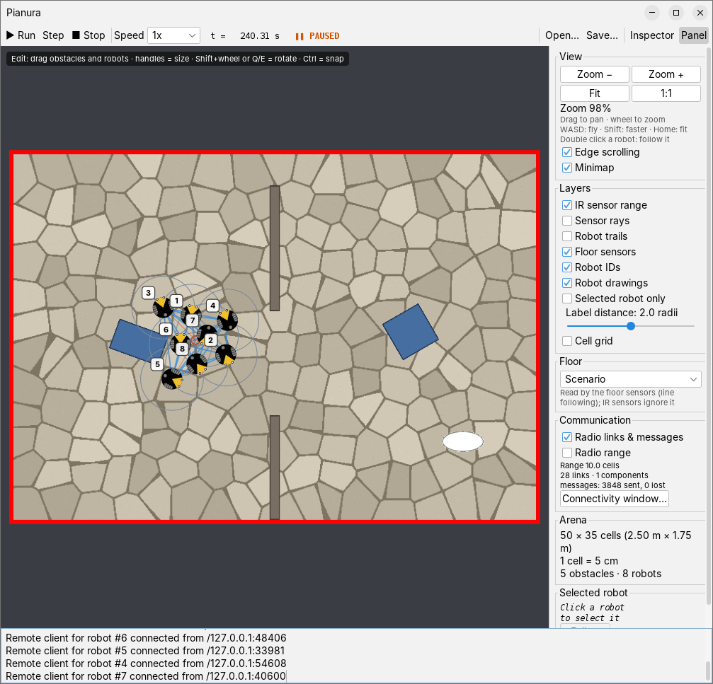

# Driving Pianura robots from Python

A ready-made Python client (`pianura_client.py`, Python 3.8 or later, standard library only) and
two examples: `wander.py` (several robots from one program) and `brain.py` with `swarm.py` (one
program per robot). The protocol, the modes and the Pianura side are described in
[`../README.md`](../README.md).

## Quick start

1. Run the example `remote` from the project root: `./gradlew run -Pexample=remote`. It opens
   paused, with two remote robots waiting on UDP port 5555.
2. Start the client: `python3 wander.py 1 2`
3. Press **Run** (or Space) in Pianura.

## Writing your own client

```python
from pianura_client import PianuraRobot

with PianuraRobot(robot_id=1) as robot:
    while True:
        s = robot.sensors()          # blocks until the next reading
        robot.drive(1.0, 0.0)        # answer every reading exactly once (drive or wheels)
```

Radio messages:

```python
        for m in s.inbox:                    # Message(sender, to, t, data); to is None for a broadcast
            print(f"from {m.sender}: {m.data}")
        robot.broadcast({"x": s.x, "y": s.y})
        robot.send(2, "only for robot 2")
        robot.drive(1.0, 0.0)                # the messages leave with this command
```

Debug drawings over the arena, in named layers (coordinates in cells; colors by name,
`"#rrggbb"` or `(r, g, b)`):

```python
        robot.layer("plan").clear().polyline(xs, ys, color="blue").disc(gx, gy, 0.3, color="red")
        robot.layer("trail").point(s.x, s.y)            # never cleared: it grows
        robot.drive(1.0, 0.0)                           # the drawings leave with this command
```

Shapes: `point`, `line`, `arrow`, `circle`, `disc`, `rect`, `polyline`, `polygon`, `text`;
`robot.clear_drawings()` clears every layer.

Pianura's **Inspector** window shows the algorithm's state, values, time plots and log:

```python
        robot.inspect.state("searching").watch("nodes", n).plot("error", e).log("goal seen")
```

`wander.py` sends a beacon every second with its position, prints which robots it can hear and
draws a line to where it believes each neighbour is (layer `radio`); in the Inspector it shows
whether it is cruising or turning away, its front IR reading and how many neighbours it hears.

## One brain per robot

Each robot can have a program of its own: its brain. `brain.py` is the brain of one robot and
`swarm.py` starts one brain process per robot:

1. `./gradlew run -Pexample=brains` from the project root: eight remote robots, paused
   (`--args=12` for twelve, up to 28).
2. `python3 swarm.py 8`, or `python3 brain.py 3` in a terminal of its own for each robot.
3. Press **Run** (or Space) in Pianura.

The brains share nothing: each knows what its robot senses and what it hears on Pianura's radio,
which has a limited range and can lose messages. Their task is aggregation. Every half second a
brain broadcasts where it is and how big its group is. It goes to a neighbour from a bigger
group if it hears one, otherwise to the centre of the robots it hears, and stops there. A small
group that stays small breaks up for a while to explore, so that groups out of radio range of
each other can still meet. Layer `group` shows where each brain thinks its group is; the
Inspector shows its state, how many neighbours it hears and how far the centre is.

In lockstep mode the simulation waits for every brain at every step, so a brain can take its
time (a neural network, a planner, a language model) without changing what happens: replace
`Brain.decide()` with yours. Pianura waits up to 1 s per answer, then keeps the robot's last
command; for slower brains start the example with `--args="8 --wait 30"` (seconds). A brain can also run on another computer: start the example with
`--args="8 --lan"` and the brains with `--host <address of the Pianura machine>`.



