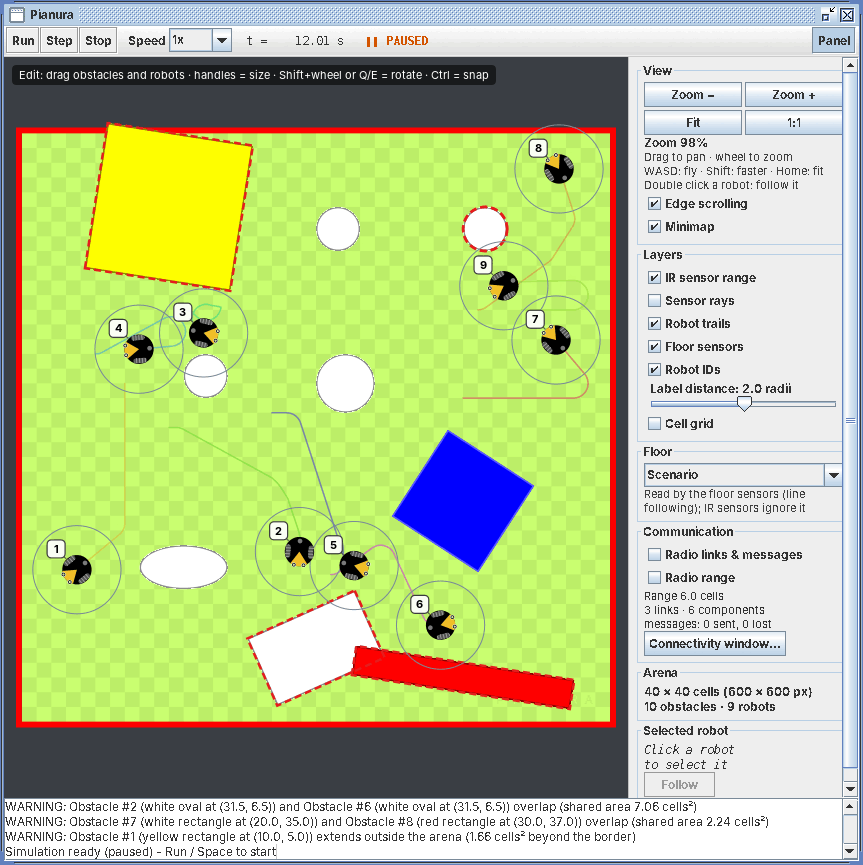
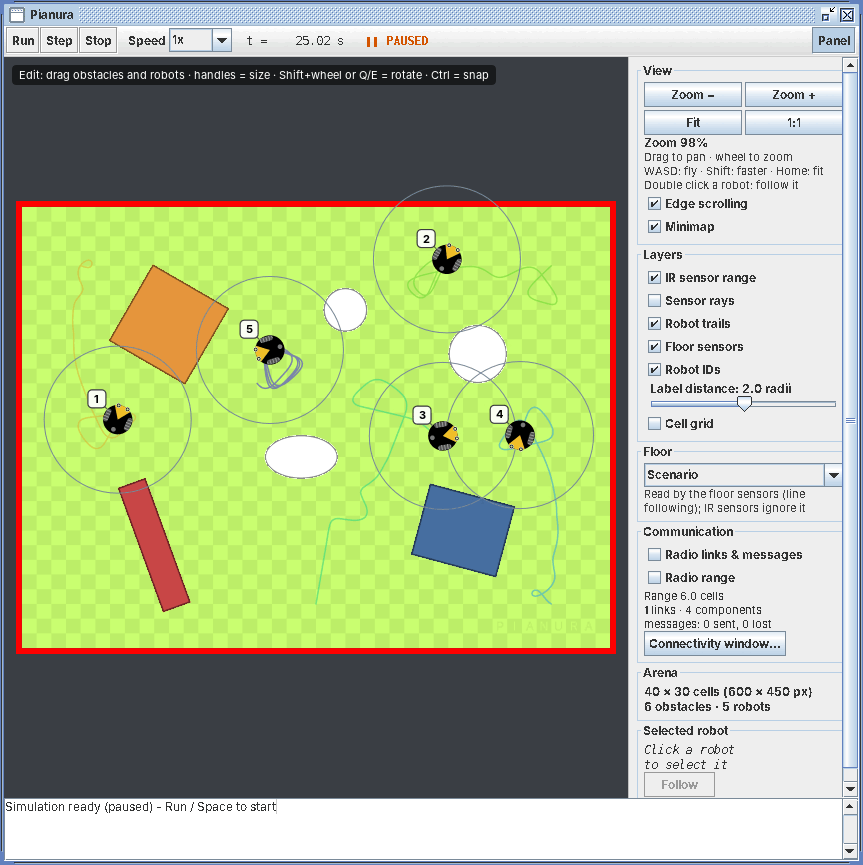
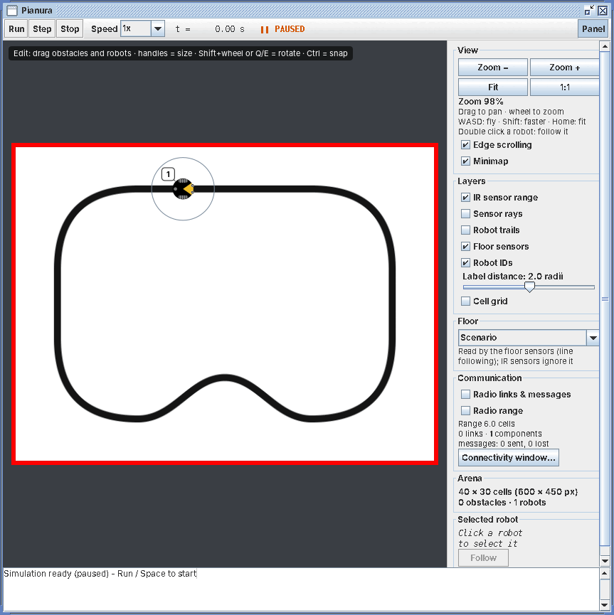
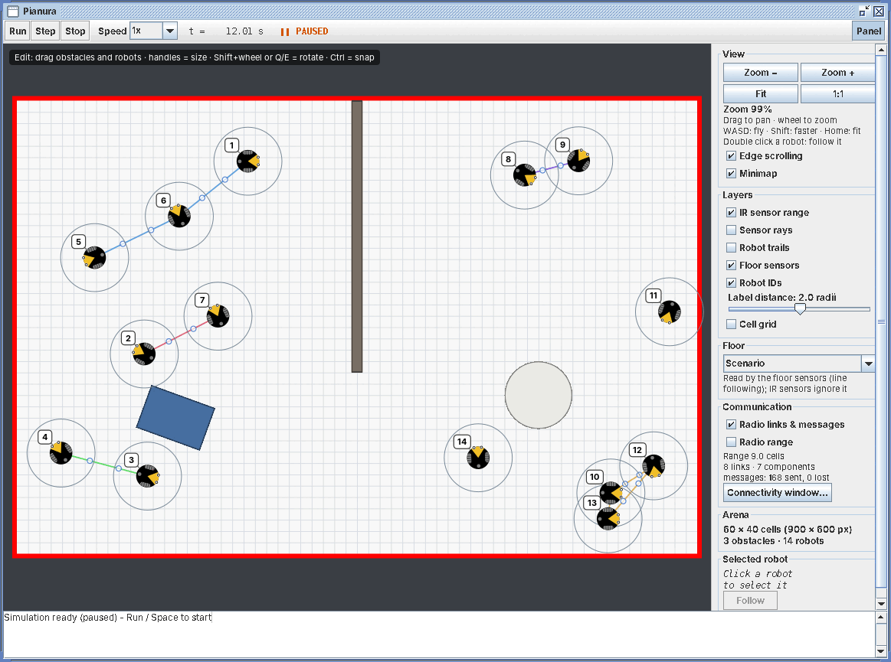

# Examples

Each example is a package under `io.github.raffaelegrandi.pianura.examples`: a scenario (arena,
obstacles, robots) plus a `Main` that starts it. The robot controllers are in
[`../algorithms`](../algorithms/README.md).

## Running

From the repository root:

```bash
./gradlew run                       # obstacles, the default demo
./gradlew run -Pexample=braitenberg # any other example, by name
```

An unknown name stops the build with the list of the available ones. Examples open paused:
arrange the scene if you like, then press **Run** (or Space).

## The examples

| Example | What it shows | Controller | Origin |
|---|---|---|---|
| `timedmotion` | Two robots in an open arena, moving open-loop | `TimedMotion` | JUSE, 2008–2011 (was `testRobots3`) |
| `obstacles` | Nine robots and mixed obstacles; some obstacles overlap or stick out of the arena on purpose, to show the scenario warnings | `IrAvoider` | JUSE, 2008–2011 (was `testRobots4`) |
| `rooms` | An 80×50 arena with a stone floor, rooms and corridors: zoom, pan and the side panel | `IrAvoider` | added 2026 |
| `linefollowing` | A track on the floor and a robot with two optical sensors under its nose. The controller is empty: writing it is the exercise | none (yours) | added 2026 |
| `remote` | Two robots driven from outside over UDP, waiting for a client (see [`../clients/python`](../clients/python)) | remote | added 2026 |
| `radio` | Fourteen robots exchanging radio beacons, with the connectivity window | `BeaconWanderer` | added 2026 |
| `largemap` | A 300×200 building generated from a seed, explored by 60 robots: fly over it with the minimap | `BeaconWanderer` | added 2026 |
| `braitenberg` | Five Braitenberg vehicles with trails on | `BraitenbergVehicle` | added 2026 |

|  |  |
|---|---|
| `obstacles` | `braitenberg` |
|  |  |
| `linefollowing` | `radio` |

## Adding an example

1. Create a package under `io.github.raffaelegrandi.pianura.examples`, named after what the
   example shows.
2. Add a `<Name>Scenario` that extends `ScenarioManager`, and a `Main` that builds a `Simulator`
   with it and calls `startSimPaused()`.
3. Add a row to the table above. `./gradlew run -Pexample=<name>` finds it automatically.

The tests in `src/test` run some examples without a GUI: the determinism of `obstacles`, its
scenario warnings, and the behaviour of the Braitenberg vehicles.
